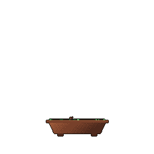

# 🌿 Bayu Wissasono

**Frontend Tinkerer & Informatics Student at UIN Sunan Kalijaga**  
*Turning Figma frames into clean, snappy web interfaces with TypeScript, React, and modern backends.*

Yogyakarta, Indonesia &nbsp;·&nbsp; [Email Me](bayu1171@gmail.com) &nbsp;·&nbsp; [LinkedIn](https://www.linkedin.com/in/bay-wicakson0/) &nbsp;·&nbsp;

 

<!-- Living Git Bonsai (Managed via .github/workflows/bonsai.yml) -->

  🪴 <b>Digital Bonsai Garden</b>: It grows branches when I commit code and sprouts sakura during streaks.

---

### 🍵 A Quick Hello

I am an undergraduate informatics student based in Yogyakarta, focused on building clean, type-safe, and responsive web applications.

What guides my daily work:
- **Design to code bridge**: I like closing the gap between static design in Figma and living code in the browser. A layout should look deliberate and feel effortless on every screen size.
- **Frontend with fullstack context**: Most of my day is spent in TypeScript and React with Tailwind CSS, backed by REST APIs built with Express.js or Laravel, and relational databases like PostgreSQL.
- **AI-assisted speed, human taste**: I actively use AI coding assistants to accelerate boilerplate, brainstorm edge cases, and scaffold features rapidly. AI provides the velocity, but architecture decisions, performance budgets, and interface polish stay strictly human-curated.
- **Pruning the unnecessary**: Just like caring for a bonsai, good engineering is about knowing what to keep and what to cut. Type safety over runtime guessing, zero layout shifts, and readable code over clever hacks.

---

### 🪴 The Daily Stack

No wall of 50 random badges. Just the tools I actually open and ship with:

- **Frontend core**: TypeScript, React, JavaScript (ES6+), Tailwind CSS, HTML5, modern CSS
- **Backend & data**: Express.js, Node.js, PostgreSQL, Laravel, PHP, REST APIs
- **Design & workflow**: Figma, Git, VS Code, Postman
- **AI acceleration**: GitHub Copilot, Claude Code, Gemini CLI *(for rapid prototyping and test scaffolding)*

> *Rule of thumb: Design in Figma first to save hours of blind coding, leverage AI to move quickly, and keep the final codebase lean and human-verified.*

---

### 🔨 What I Have Been Building

<table>
  <tr>
    <td width="50%" valign="top">
      <h3>🔍 SukaKetemu</h3>
      
Sistem smart lost and found kampus menggunakan multimodal similarity matching (teks dan gambar) serta estimasi lokasi berbasis jaringan Wi-Fi untuk mempercepat temu kembali barang hilang.

      

        <code>TypeScript</code> · <code>Express.js</code> · <code>PostgreSQL</code> · <code>Multimodal AI</code>
      

      

        👉 <a href="https://github.com/Wissasono11/SukaKetemu">Source Code</a>
      

    </td>
    <td width="50%" valign="top">
      <h3>🚀 NeoKarir</h3>
      
Platform asisten karier berbasis AI untuk menganalisis profil pengguna, memetakan tren pasar kerja, dan menghasilkan roadmap karier terpersonalisasi untuk menjembatani skill gap.

      

        <code>React</code> · <code>TypeScript</code> · <code>Tailwind CSS</code> · <code>AI Integration</code>
      

      

        👉 <a href="https://github.com/slmnalfauzi/capstone-project-neokarir">Source Code</a> &nbsp;|&nbsp; 
        🌐 <a href="https://neokarir.vercel.app">Live Demo</a>
      

    </td>
  </tr>
</table>

---

### 🎯 Current Focus & Side Quests

- [x] Building type-safe React applications with TypeScript
- [x] Designing relational schemas with PostgreSQL and Express.js / Laravel
- [x] Integrating AI developer workflows to scaffold prototypes and test suites faster
- [ ] Exploring micro-interactions, smooth page transitions, and web accessibility
- [ ] Shipping my next fullstack side project

---

### 📬 Say Hi

Have a cool frontend problem to solve, an open-source collaboration idea, or want to discuss AI-assisted developer workflows?

- Drop me a line on [LinkedIn](https://www.linkedin.com/in/bay-wicakson0/)
- Send an email to [your-email@gmail.com](bayu1171@gmail.com)

---

  Watered daily with black coffee & genuine curiosity.

